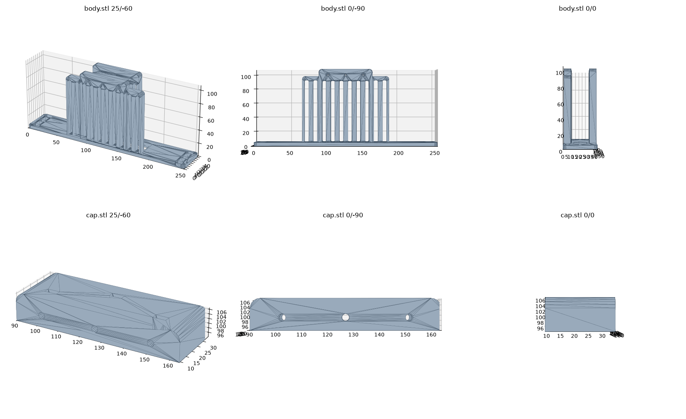

# SODOLA SL902 switch mount for a 10" rack

3D-printable 1U bracket that holds a **SODOLA SL902** desktop switch (**4× 2.5G RJ45 + 2× 10G SFP+**, ~200 × 130 × 30 mm body) in a **10-inch rack**. The switch sits in a tray behind a 10" front panel; a small clamp cap locks it in place. No cutting or drilling on the rack or the switch.

## Files

| File | Use |
|---|---|
| `body.stl` | The tray + 1U 10" front panel (254 × 44.2 × 106.6 mm). |
| `cap.stl` | Clamp cap (74 × 25.5 × 12.5 mm) that presses onto the switch inside the tray. |

## Measure before you print

The design fits one switch in one rack. Check these on yours:

1. Switch body width and depth: it should drop into the tray with a little side play.
2. Panel: 10" rack, 1U (six 12.0 × 6.3 mm slots, 3 per side, for M6 rack screws + cage nuts).
3. Clamp cap screws: 3× M3 (3.0 mm holes in the cap; the tray has two hex pockets for ~5.9 mm M3 nuts and one 3.0 mm hole).

## Parts needed

- 4–6× M6 rack screws + cage nuts (often included with the rack)
- 3× M3 screws, 16–20 mm (measure the stack-up in your tray before buying)
- 3× M3 nuts

## Print settings

- PETG or ASA, black, 0.4 mm nozzle
- 40 % infill worked well; the panel is the structural part
- Print the body with the panel flat on the bed; no supports needed for the tray as printed

## Assembly

1. Screw the body to the rack with M6 rack screws and cage nuts.
2. Slide the switch into the tray, ports facing the front panel.
3. Place the clamp cap on top and fix it with the M3 screws and nuts.

## Credit

The original geometry was downloaded as STLs on 25 Sep 2026 from a free 3D-print model site and the author could not be re-identified afterwards. If you are the author of this bracket: thank you for sharing it — please open an issue and I will credit you here (or take this down, your choice).

Made for the rack build at [niklaslenz.com](https://niklaslenz.com).
